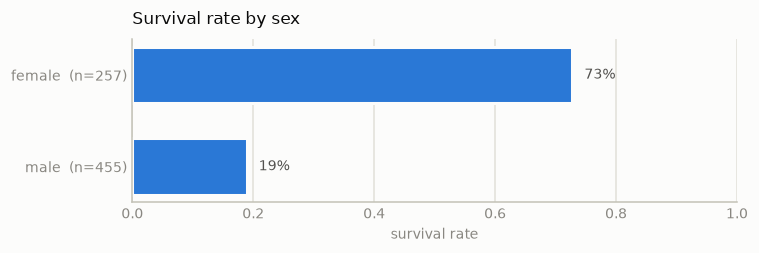
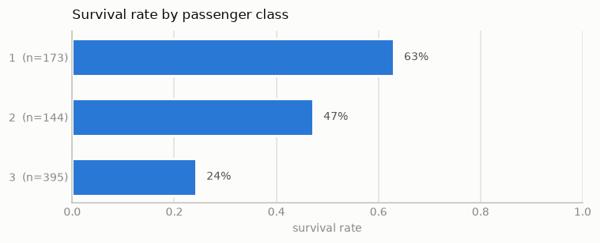
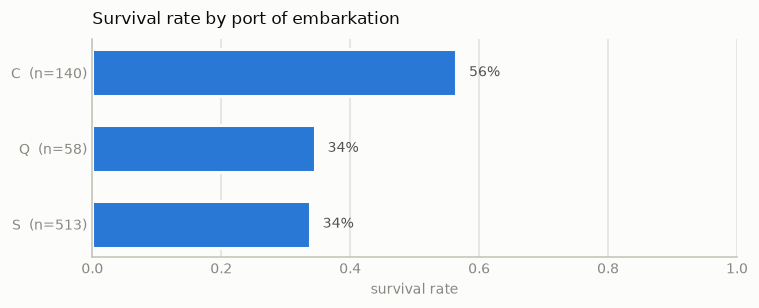
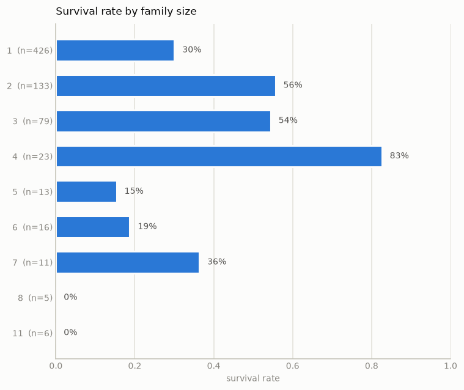
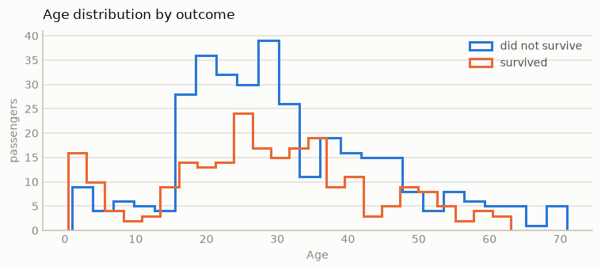
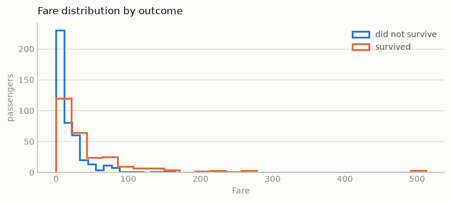
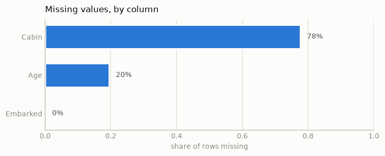

# 02 — Exploration (frozen training split)

Generated by `make explore` (step 5). Regenerable: `make clean` removes it.

Read from `data/frozen/train.csv` only. **`holdout.csv` was not opened** —
see Rule 2 in [CLAUDE.md](../CLAUDE.md). Charting the holdout would spend
the one honest estimate this pipeline has.

## The number to beat

Majority-class baseline accuracy: **0.6166**.

That is the whole of the target-balance story, so it is a figure rather than
a chart — two values do not need an axis. Whether a model beats it is a
result to report, not a target to re-roll a search against.

## Survival rate by sex

| group | value |
| --- | --- |
| female | 0.7276 |
| male | 0.1890 |

## Survival rate by passenger class

| group | value |
| --- | --- |
| 1 | 0.6301 |
| 2 | 0.4722 |
| 3 | 0.2430 |

## Survival rate by port of embarkation

| group | value |
| --- | --- |
| C | 0.5643 |
| Q | 0.3448 |
| S | 0.3372 |

## Survival rate by family size

| group | value |
| --- | --- |
| 1 | 0.3005 |
| 2 | 0.5564 |
| 3 | 0.5443 |
| 4 | 0.8261 |
| 5 | 0.1538 |
| 6 | 0.1875 |
| 7 | 0.3636 |
| 8 | 0.0000 |
| 11 | 0.0000 |

## Age distribution by outcome

| group | value |
| --- | --- |
| did not survive (median) | 28.0000 |
| survived (median) | 27.5000 |

## Fare distribution by outcome

| group | value |
| --- | --- |
| did not survive (median) | 10.5000 |
| survived (median) | 26.0000 |

## Missing values, by column

| group | value |
| --- | --- |
| Cabin | 0.7767 |
| Age | 0.1952 |
| Embarked | 0.0014 |

## Candidate features

Carried to `tune` via `02_explore.json`.

- Raw columns worth keeping: `Sex`, `Pclass`, `Age`, `Fare`, `SibSp`, `Parch`, `Embarked`. `Name`, `Ticket`, `Cabin` and `PassengerId` are excluded as raw features — step 2 flagged all four as high-cardinality, and the first and last as effectively row identifiers.
- `FamilySize` — SibSp + Parch + 1; survival is non-monotonic in family size, so the raw counts split the signal in two.
- `IsAlone` — FamilySize == 1; a single threshold that the trees find anyway but linear models cannot express.
- `Title` — Extracted from Name (Mr/Mrs/Miss/Master/rare). Carries sex and rough age together, and survives Age being 20% missing.
- `Deck` — First letter of Cabin, with a missing category. Cabin itself is 77% missing and near-unique among observed rows, so the letter is the only part that generalises.
- `AgeMissing` — Indicator for a missing Age. Whether the age was recorded is itself informative; imputing it away discards that.

All of these are computed **inside** the modelling pipeline, fitted per fold.
Deriving them once over the whole training split before cross-validation
leaks across folds and inflates the score.
